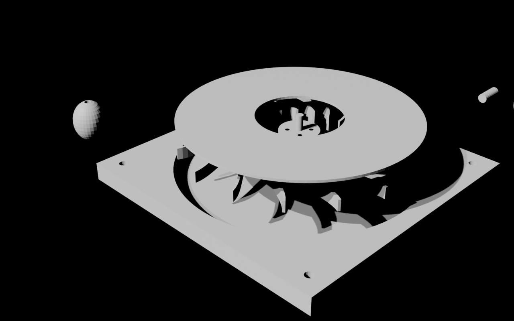

# OpenBreeze 3D Print & Slicing Guide (Prototype 1)

All parts are designed to be printed on any standard FDM 3D printer ($220\times 220\text{ mm}$ bed or larger) using **1.75mm PETG filament**.

---

## 1. Universal Slicer Settings for Airtight, Low-Noise PETG Parts

| Setting | Recommended Value | Reason |
| :--- | :--- | :--- |
| **Material** | **PETG** | High impact strength, good flexural fatigue resistance, zero toxic styrene/VOCs (unlike ABS), food/skin contact safe. |
| **Nozzle Diameter** | **$0.4\text{ mm}$** *(or $0.6\text{ mm}$)* | Standard $0.4\text{ mm}$ nozzle gives sharp blade edges and clean balance holes. |
| **Layer Height** | **$0.20\text{ mm}$** | Balances vertical resolution with interlayer tensile bond strength. |
| **Perimeter Walls** | **4 Walls** (minimum $1.6\text{ mm}$) | ⚠️ **Critical for Airtightness**: 2-wall prints leak air through layer seams. 4 walls make the volute airtight at $20\text{ cmH}_2\text{O}$. |
| **Top & Bottom Layers** | **5 Top / 5 Bottom** | Guarantees pinhole-free top and bottom skins. |
| **Infill Density & Pattern** | **25% Gyroid** | Isotropic strength; gyroid infill does not vibrate or resonate like grid infill. |
| **Extrusion Multiplier (Flow)** | **$103\%\text{ to }105\%$** | Slight over-extrusion fuses inter-layer micro-voids for pneumatic sealing. |
| **Seam Position (Impeller)** | **Random** | ⚠️ **Critical for Rotor Balance**: Never use "Aligned" or "Rear" seam on the impeller. Aligned seams deposit a ridge of extra plastic on one side of the wheel, creating rotational unbalance. |

---

## 2. Part-by-Part Printing Orientation & Notes

### Part 1: Impeller Blade Disk (`part1_impeller_disk.stl`)
* **Orientation**: Print flat on the build plate with the flat bottom of the disk resting on the bed (blades pointing UP).
* **Supports**: **NO SUPPORTS NEEDED**. The blades rise directly from the floor; the central hub is vertical.
* **Seam**: Set to **"Random"**.
* **Post-Processing**: Inspect blade tips for any stringing; use flush cutters to snip any stray hairs.

### Part 2: Impeller Snap-On Shroud Ring (`part2_impeller_shroud.stl`)
* **Orientation**: Print flat on the build plate with the bevel side UP (flat groove side resting on the bed or vice versa).
* **Supports**: **NONE**.
* **Assembly**: Place a tiny dab of cyanoacrylate superglue (CA glue) onto the tip of each of the 16 blades on Part 1. Press Part 2 down firmly onto Part 1 until the 16 alignment tongues snap into the shroud grooves. Let cure for 15 minutes. You now have a rigid shrouded centrifugal wheel with 100% smooth internal passages!

### Part 3: Volute Backplate (`part3_volute_backplate.stl`)
* **Orientation**: Print with the external flat motor-mounting face resting on the build plate (cavity facing UP).
* **Supports**: **NONE**. The bearing boss and motor screw recesses print cleanly on the bed surface.
* **Assembly**: Bolt the `775` 12V motor to the rear face using **2x `M4 x 10mm` screws and washers**. The front bearing boss of the motor nests directly into the $17.8\text{ mm}$ central counterbore.

### Part 4: Volute Front Cover (`part4_volute_frontcover.stl`)
* **Orientation**: Print with the flat outer flange face resting on the build plate (scroll cavity facing UP).
* **Supports**: Use **tree supports** only under the protruding tangential $22\text{ mm}$ outlet spigot.
* **Assembly**: Lay a continuous $2\text{ mm}$ bead of neutral-cure silicone sealant (or hot glue) around the perimeter gasket groove of Part 3. Clamp Part 4 to Part 3 using **8x `M3 x 16mm` screws and nuts**.

### Part 5: 32mm Silencer Perforated Core (`part5_silencer_perforated_core.stl`)
* **Orientation**: Print standing vertically on one of its solid $18\text{ mm}$ end cuffs.
* **Brim**: Recommended $5\text{ mm}$ outer brim for bed adhesion.
* **Supports**: **NONE**. The $3\text{ mm}$ round acoustic holes bridge cleanly without supports.
* **Assembly**: Wrap the central perforated section with 2 layers of breathable cotton cloth / old bath towel. Slide one end over the $22\text{ mm}$ outlet spigot of Part 4 using a $1\text{-}1/4\text{"}$ to $22\text{ mm}$ flexible coupler.

### Part 6: Prototype 1 Life-Safety Alarm Elbow (`part6_safety_alarm_elbow.stl`)
* **Orientation**: Print with the machine-side $22\text{ mm}$ male taper resting on the build plate.
* **Supports**: Tree supports for the $90^\circ$ overhang and alarm dock.
* **Flapper Door Assembly**:
  1. Print the small flapper door flat on the bed.
  2. Slide an unbent steel safety pin wire through the hinge lugs and the door barrel.
  3. Form a small torsion loop in the safety pin wire so the spring gently holds the door **OPEN** (pointing outward) with $\sim 10\text{ gf}$ of opening torque.
  4. Glue the small magnet from the Dollar-Tree window alarm into the flapper door's magnet pocket.
  5. Slide the main alarm sensor box into the dock bracket. When the blower runs ($\ge 3\text{ cmH}_2\text{O}$), positive pressure pushes the flapper door shut against the 3 point nibs, placing the magnet next to the alarm sensor (silent). If pressure drops below $2.5\text{ cmH}_2\text{O}$, the safety pin snaps the door open, triggering the $90\text{ dB}$ siren.

### Part 7: U-Tube Manometer Splash Traps & Bracket (`part7_manometer_splash_traps.stl`)
* **Orientation**: Print bulbs vertically on their bottom hose barb; print the 25 cm scale bracket flat on its back.
* **Supports**: Tree supports under bulb overhangs.
* **Assembly**: Connect one splash-trap bulb to the static pressure tap barb on Part 4 via $1/4\text{"}$ vinyl tubing. Fill the U-tube halfway with water (+ 1 drop of food coloring). Snap both legs into the printed centimeter bracket on the outside of the bucket.

---

## 3. 3-Minute Precision Static Balancing Procedure

Before bolting the impeller into the housing:
1. Push the $5\text{ mm}$ metal flange shaft coupler (or $5\text{ mm}$ steel drill bit / rod) into the central hub.
2. Rest the two ends of the steel shaft horizontally across the rims of **two identical drinking glasses** on a level table.
3. Gently roll the wheel. The heavy side will roll to the bottom ($6\text{ o'clock}$).
4. Take a short snippet of raw $1.75\text{ mm}$ PETG filament ($10\text{ mm} \approx 0.03\text{ g}$) and press it into one of the 24 perimeter balance holes at $12\text{ o'clock}$ (the light side).
5. Repeat until the wheel remains completely stationary in **any rotational position** (neutral equilibrium). Secure the filament snippet with a tiny drop of superglue.
